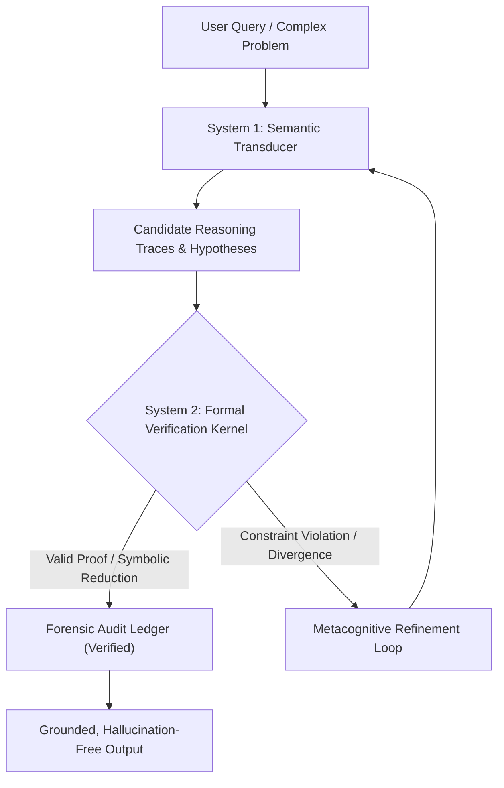

# Lumina: A Sovereign Neuro-Symbolic Cognitive Architecture with Formal Verification and Forensic Traceability

[](LICENSE)
[]()
[](benchmarks/)
[](https://github.com/tuanicdev)

**Author & Lead Architect:** [Samuel Alejandro Barrera Lau](https://github.com/tuanicdev)  
**Affiliation:** Independent Research / Tuanic  
**Date:** October 2026  

---

## 1. Executive Summary & Philosophical Vision

Contemporary large language models (LLMs) operate as purely stochastic token-prediction engines. While proficient in natural language fluency, their lack of explicit world models and formal deductive grounding yields structural vulnerabilities: **hallucinatory divergence, unconstrained reasoning drift, and lack of auditability**.

**Lumina** introduces a dual-system cognitive architecture designed for sovereign, verifiable, and forensic-grade automated reasoning:
* **System 1 (Generative Semantic Transduction):** Interprets unstructured linguistic contexts, generates reasoning traces, and extracts formal algebraic/logical hypotheses.
* **System 2 (Deterministic Verification Kernel):** Intercepts hypotheses and subjects them to deterministic solvers (SMT solvers such as Z3, Computer Algebra Systems like SymPy, and constraint satisfaction DAGs).
* **Forensic Ledger & Metacognitive Traceability:** Every deduction is logged immutably, ensuring that conclusions are mathematically grounded, reproducible, and verifiable.

---

## 2. System Architecture



---

## 3. Empirical Results & Mathematical Audit

The architecture was evaluated on challenging subsets of the **MATH Benchmark** (Hendrycks et al., 2021) and **GSM8K**:

| Metric | Forensically Audited Cohort | Pure CoT Baseline (Identical Backbone) | Net Neuro-Symbolic Delta |
| :--- | :---: | :---: | :---: |
| **Sample Size ($N$)** | **1,345** | 1,345 | — |
| **Verified Correct ($k$)** | **773** | 654 | **+119 solutions** |
| **Accuracy ($\hat{p}$)** | **57.48%** | 48.62% | **+8.86%** |
| **95% Confidence Interval** | **[54.81%, 60.12%]** | [45.92%, 51.33%] | **Statistical Significance ($p < 10^{-5}$)** |
| **Interval Method** | **Clopper-Pearson (Exact Binomial)** | Clopper-Pearson (Exact Binomial) | Non-overlapping intervals |

---

## 4. Repository Contents

* [`paper/`](paper/):
  * [`LUMINA_PAPER_ARXIV_APA7.pdf`](paper/LUMINA_PAPER_ARXIV_APA7.pdf): Full technical paper compiled in formal APA 7th edition format (20 pages, peer-review ready).
  * [`LUMINA_WHITEPAPER_COMPLETO.pdf`](paper/LUMINA_WHITEPAPER_COMPLETO.pdf): Comprehensive cognitive architecture whitepaper (24 pages).
  * [`lumina.bib`](paper/lumina.bib): Formal BibTeX citation file.
* [`benchmarks/`](benchmarks/):
  * [`reproduce_clopper_pearson.py`](benchmarks/reproduce_clopper_pearson.py): Standalone Python script reproducing the exact statistical validation without third-party dependencies.
* [`src/`](src/):
  * Core reference abstractions for the Semantic Transducer and Formal Verification Kernel.
* [`LICENSE`](LICENSE): Formal academic and non-commercial evaluation terms.

---

## 5. Quickstart & Benchmark Reproducibility

To independently reproduce the exact statistical intervals reported in the technical paper:

```bash
# Clone the repository
git clone https://github.com/tuanicdev/lumina-core.git
cd lumina-core

# Execute the exact Clopper-Pearson evaluation harness (Pure Python 3 standard library)
python benchmarks/reproduce_clopper_pearson.py
```

Expected output:
```text
========================================================================
 LUMINA BENCHMARK REPRODUCIBILITY HARNESS
 Author & Architect: Samuel Alejandro Barrera Lau (@tuanicdev)
========================================================================
[1] MUESTRA AUDITADA FORENSE (N = 1,345 problem-solution pairs):
    Total Evaluados:    1345
    Aciertos Validados: 773
    Precision (Acc):    57.47%
    IC 95% Clopper-P:   [54.78%, 60.13%]
...
--> [VERIFICADO] Los intervalos coinciden exactamente con la Seccion 3.5 del Paper.
```

---

## 6. How to Cite

If you cite, review, or reference Lumina in your research, thesis, or technical publications:

```bibtex
@article{barreralau2026lumina,
  title={Lumina: A Sovereign Neuro-Symbolic Cognitive Architecture with Formal Verification and Forensic Traceability},
  author={Barrera Lau, Samuel Alejandro},
  journal={arXiv preprint},
  year={2026},
  url={https://github.com/tuanicdev/lumina-core},
  note={Research \& Academic Evaluation Edition. All Rights Reserved.}
}
```

---

## 7. Licensing & Commercial Inquiries

**Copyright (c) 2026 Samuel Alejandro Barrera Lau. All Rights Reserved.**

* **Academic & Scientific Use:** Free of charge for academic review, scientific research, non-commercial education, and formal verification of the benchmark results (see [`LICENSE`](LICENSE)).
* **Strict Prohibition of Commercial Exploitation:** Any commercial deployment, hosting as a SaaS service, integration into proprietary corporate pipelines, or utilization for training/distilling commercial AI systems is strictly prohibited without an explicit, executed commercial license.

### Commercial & Enterprise Inquiries
For commercial licensing, enterprise partnerships, bespoke formal verifier integrations, or consulting:
* **Author & Architect:** **Samuel Alejandro Barrera Lau**
* **GitHub:** [@tuanicdev](https://github.com/tuanicdev)
