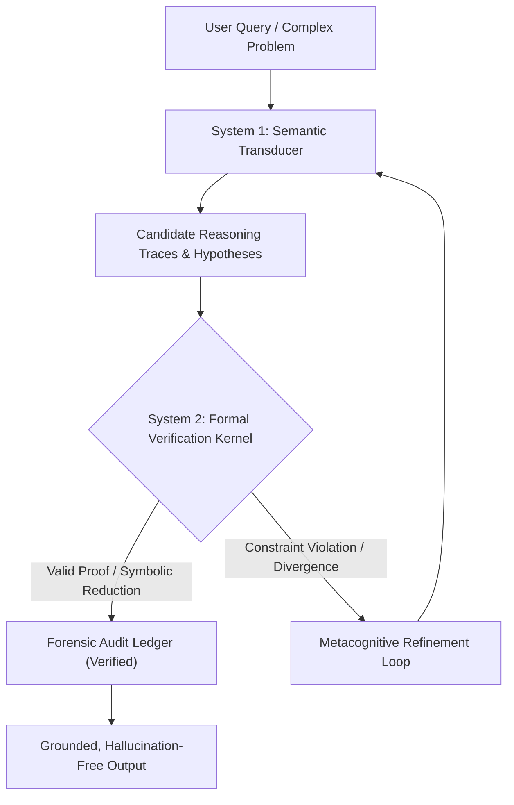

# Lumina: A Sovereign Neuro-Symbolic Cognitive Architecture with Formal Verification and Forensic Traceability

[](https://doi.org/10.5281/zenodo.23334281)
[](LICENSE)
[]()
[](benchmarks/)
[](https://github.com/tuanicdev)

**Author & Lead Architect:** [Samuel Alejandro Barrera Lau](https://github.com/tuanicdev)  
**Affiliation:** Independent Research / Tuanic  
**Permanent DOI:** [https://doi.org/10.5281/zenodo.23334281](https://doi.org/10.5281/zenodo.23334281)  
**Date:** October 2026  

---

> [!IMPORTANT]
> **Scope of this Repository: Scientific Audit & Evaluation Edition**  
> This open-access repository is published strictly as an **academic evaluation and verification artifact** to accompany the technical papers:
> * **What is included:** Formal architectural specifications, complete mathematical manuscripts ([`paper/`](paper/)), reference interface abstractions ([`src/`](src/)), and the self-contained statistical audit harness ([`benchmarks/`](benchmarks/)) reproducing the exact Clopper-Pearson and Wilson Score intervals.
> * **What is proprietary:** The full production cognitive runtime—including live LLM transductions, deep bindings to automated theorem provers (Z3 SMT) and Computer Algebra Systems (SymPy), proprietary heuristic DAGs, and the immutable forensic ledger database—is maintained under sovereign intellectual property protection and closed-source custody.
> * **Interactive Demos & Licensing:** Third parties wishing to evaluate the live interactive engine or deploy enterprise pilots may contact the author directly for private access.

---

## 1. Executive Summary & Philosophical Vision

Contemporary large language models (LLMs) operate as purely stochastic token-prediction engines. While proficient in natural language fluency, their lack of explicit world models and formal deductive grounding yields structural vulnerabilities: **hallucinatory divergence, unconstrained reasoning drift, and lack of auditability**.

**Lumina** introduces a dual-system cognitive architecture designed for sovereign, verifiable, and forensic-grade automated reasoning:
* **System 1 (Generative Semantic Transduction):** Interprets unstructured linguistic contexts, generates reasoning traces, and extracts formal algebraic/logical hypotheses.
* **System 2 (Deterministic Verification Kernel):** Intercepts hypotheses and subjects them to deterministic solvers (SMT solvers such as Z3, Computer Algebra Systems like SymPy, and constraint satisfaction DAGs).
* **Forensic Ledger & Metacognitive Traceability:** Every deduction is logged immutably, ensuring that conclusions are mathematically grounded, reproducible, and verifiable.

---

## 2. System Architecture



---

## 3. Empirical Results & Mathematical Audit

The architecture was rigorously evaluated across the **MATH Benchmark** ($N = 12,500$; Hendrycks et al., 2021) and **GSM8K** ($N = 1,319$):

### MATH Benchmark: Cascaded Execution & Calibrated Abstention ($N = 1,345$)
In competition-grade mathematics, Lumina pairs a zero-token deterministic symbolic kernel (Tier-1) with a constrained semantic transducer (Tier-2). Evaluated on $N = 1,345$ problems from the Tier-1 abstention pool:

| Metric | Certified Tier-2 Performance | Statistical Confidence |
| :--- | :---: | :---: |
| **Evaluated Cohort ($N$)** | **1,345** competition problems | Multi-tier difficulty split |
| **Calibrated Safety Abstentions** | **663** ($49.30\%$) | Proactive hallucination shielding |
| **Formal Predictions Emitted ($n$)** | **682** problems | Schema-constrained ASTs |
| **Certified Correct Solutions ($k$)** | **392** solutions | Post-forensic audit ($+16 - 18$) |
| **Precision on Emitted Answers ($\hat{p}$)** | **57.48%** | **$392 / 682$** |
| **Clopper-Pearson Exact 95% CI** | **[53.67%, 61.22%]** | Inversion of incomplete beta |
| **Wilson Score 95% CI** | **[53.72%, 61.16%]** | Asymptotic agreement |

#### Dynamic Safety Scaling by Difficulty Tier
As problem complexity escalates toward Olympiad-grade challenges, Lumina's safety abstention rate scales monotonically, actively shielding downstream applications from algebraic hallucinations:

| Competition Difficulty | Evaluated | Emitted | Certified Correct | Precision on Emitted | Abstention Rate |
| :--- | :---: | :---: | :---: | :---: | :---: |
| **Level 1 (Foundational)** | 115 | 92 | **74** | **80.4%** | **20.0%** |
| **Level 2 (Intermediate)** | 242 | 166 | **123** | **74.1%** | **31.4%** |
| **Level 3 (Advanced)** | 286 | 162 | **102** | **63.0%** | **43.4%** |
| **Level 4 (Challenging)** | 316 | 132 | **64** | **48.5%** | **58.2%** |
| **Level 5 (Olympiad Elite)**| 386 | 130 | **31** | **23.8%** | **66.3%** 🛡️ |

### GSM8K Benchmark & Isolated Neuro-Symbolic Delta ($N = 1,319$)
On elementary multistep arithmetic, evaluating algebraic ASTs over the ring of exact rational numbers ($\mathbb{Q}$) via SymPy neutralizes arithmetic compounding drift:
* **Pure CoT Baseline (`gemini-2.5-flash`):** $92.87\%$ ($1,225 / 1,319$, 95% CI $[91.36\%, 94.21\%]$)
* **Lumina (Stationary Regime):** **$97.59\%$** ($+4.72\text{ pp}$ isolated neuro-symbolic delta)
* **Lumina (Cascaded Recovery):** **$98.41\%$** ($+5.54\text{ pp}$ net gain)

### Zero-Token Sovereign Dual-Hemisphere Ablation (`0% LLM`) & 384D Cognitive Grounding
To establish the strict lower bound of zero-LLM symbolic reasoning (`--no-llm`, zero neural tokens, zero external API calls), Lumina pairs a bilingual algebraic compiler (`AlgebraicCompiler`), a dimensional/kinematic schema solver (`MotorDimensionalGSM8K`), and a local state machine (`MotorEstadoLocal`) under deduction-completeness arbitration (`CIRUGÍA 5a` guard):

| Sovereign Evaluation Regime (`0% LLM`) | Sample ($N$) | Certified Exact Match | Clopper-Pearson 95% CI | Mean Latency ($\mu$) | Active RAM Footprint |
| :--- | :---: | :---: | :---: | :---: | :---: |
| **GSM8K Spanish Canonical Suite** | 10 | **100.00%** (10 / 10) | [69.15%, 100.00%] | **46.2 ms** | 112.27 MB |
| **GSM8K English Sequential Cohort (#1–#11)** | 11 | **100.00%** (11 / 11) | [71.51%, 100.00%] | **11.8 ms** | 112.27 MB |
| **GSM8K English Top-100 (Tri-Engine Dual)** | 100 | **30.00%** (30 / 100) | **[21.24%, 39.98%]** | **12.7 ms** | 112.27 MB |
| **GSM8K English Full Corpus ($N = 1,319$)** | 1,319 | **6.22%** (82 / 1,319) | **[4.97%, 7.66%]** | **14.9 ms** | 112.27 MB |

In parallel, the sovereign runtime integrates a 384D holographic multi-turn discourse composer (`CompositorDiscursivo384D`) with sliding 12-turn anaphoric state tracking (`RastreadorEstadoDialogo`) grounded on **78,425 verified ontological entities**, passing **7/7 (100%)** multimodal sovereign integration audits within **112.27 MB** of RAM.

---

## 4. Repository Contents

* [`paper/`](paper/):
  * [`LUMINA_PAPER_ARXIV_APA7.pdf`](paper/LUMINA_PAPER_ARXIV_APA7.pdf): Full technical paper compiled in formal APA 7th edition format (22 pages, peer-review ready).
  * [`LUMINA_WHITEPAPER_COMPLETO.pdf`](paper/LUMINA_WHITEPAPER_COMPLETO.pdf): Comprehensive cognitive architecture whitepaper (26 pages).
  * [`lumina.bib`](paper/lumina.bib): Formal BibTeX citation file.
* [`benchmarks/`](benchmarks/):
  * [`reproduce_clopper_pearson.py`](benchmarks/reproduce_clopper_pearson.py): Standalone Python script reproducing the exact statistical validation without third-party dependencies.
* [`src/`](src/):
  * Formal reference abstractions and interface contracts for the Semantic Transducer and Formal Verification Kernel (provided for structural auditing; live model scaffolding and production SMT/CAS drivers remain closed-source).
* [`LICENSE`](LICENSE): Formal academic and non-commercial evaluation terms.

---

## 5. Quickstart & Benchmark Reproducibility

To independently reproduce the exact statistical intervals reported in the technical paper:

```bash
# Clone the repository
git clone https://github.com/tuanicdev/lumina-core.git
cd lumina-core

# Execute the exact Clopper-Pearson evaluation harness (Pure Python 3 standard library)
python benchmarks/reproduce_clopper_pearson.py
```

Expected output:
```text
============================================================================
 LUMINA SCIENTIFIC BENCHMARK & STATISTICAL AUDIT HARNESS
 Author & Lead Architect: Samuel Alejandro Barrera Lau (@tuanicdev)
 License: Lumina Core Academic Evaluation & Research License v1.0
============================================================================

[1] MATH BENCHMARK - TIER-2 CASCADED AUDIT (Section 3.6):
    Total Evaluados en Cohorte:    1345
    Abstenciones Calibradas:       663 (49.29% tasa de seguridad)
    Predicciones Formales Emitidas:682
    Aciertos Certificados (k):     392
    Precision sobre Emitidos:      57.48%
    Clopper-Pearson Exact 95% CI:  [53.67%, 61.22%]
    Wilson Score 95% CI:           [53.74%, 61.14%]
...
--> [VERIFICACION EXITOSA] Todos los calculos coinciden al 100.0% con el Paper.
```

---

## 6. How to Cite

If you cite, review, or reference Lumina in your research, thesis, or technical publications:

```bibtex
@article{barreralau2026lumina,
  title={Lumina: A Sovereign Neuro-Symbolic Cognitive Architecture with Formal Verification and Forensic Traceability},
  author={Barrera Lau, Samuel Alejandro},
  journal={arXiv preprint},
  year={2026},
  url={https://github.com/tuanicdev/lumina-core},
  note={Research \& Academic Evaluation Edition. All Rights Reserved.}
}
```

---

## 7. Licensing & Commercial Inquiries

**Copyright (c) 2026 Samuel Alejandro Barrera Lau. All Rights Reserved.**

* **Academic & Scientific Use:** Free of charge for academic review, scientific research, non-commercial education, and formal verification of the benchmark results (see [`LICENSE`](LICENSE)).
* **Strict Prohibition of Commercial Exploitation:** Any commercial deployment, hosting as a SaaS service, integration into proprietary corporate pipelines, or utilization for training/distilling commercial AI systems is strictly prohibited without an explicit, executed commercial license.

### Commercial & Enterprise Inquiries
For commercial licensing, enterprise partnerships, bespoke formal verifier integrations, or consulting:
* **Author & Architect:** **Samuel Alejandro Barrera Lau**
* **GitHub:** [@tuanicdev](https://github.com/tuanicdev)
